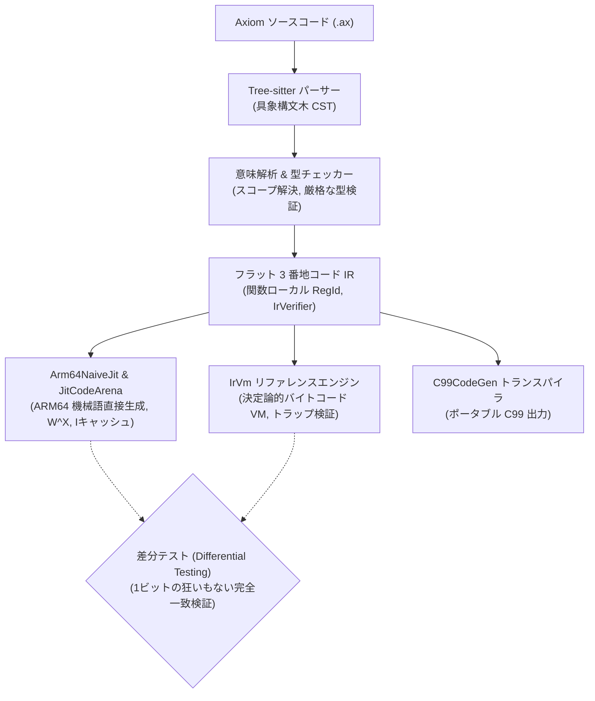

# Axiom プログラミング言語

<p align="center">
  <strong>高スループット・データ指向設計（DOD）システムプログラミング言語 & ネイティブ JIT エンジン</strong>
</p>

<p align="center">
  <a href="https://github.com/Nebula-Ray42/nexa/actions/workflows/ci.yml">
    
  </a>
  
  
  
  
</p>

---

## [English Version](README.md)

---

## ⚡ Axiom とは？

**Axiom**（アクシオム）は、**データ指向設計（DOD: Data-Oriented Design）** とゲームエンジン・リアルタイム描画アーキテクチャのためにゼロから設計されたシステムプログラミング言語です。

従来のオブジェクト指向プログラミングの階層構造を見直し、CPUキャッシュの局所性、フラットなメモリレイアウト、連続した並列データ構造（Structure of Arrays: SoA）を言語仕様およびコンパイラ設計の中核に据えています。

現在は **モダン C++23** と **自作 Tree-sitter 文法** を用いてブートストラップ（基盤構築）されており、構文解析、フラットな 3 番地コード IR、そして Apple Silicon（M1/M2/M3）の実機上でマイクロ秒オーダーで機械語を実行する **ネイティブ ARM64 JIT コンパイラ** を備えています。

---

## 🛠️ アーキテクチャとパイプライン

Axiom は決定論的なスループット、ホットパス内でのゼロ・アロケーション、および多層防御による差分検証を徹底しています：



* **フロントエンド**: 自作 Tree-sitter 文法、ゼロコピー文字列インターナー（`StringID`）、世代別ハンドルレジストリ。
* **ミドルエンド (IR)**: 関数ローカルな連番仮想レジスタ（`RegId`）、明示的制御フロー（`Jump`, `BranchIfFalse`, `Label`）、および自動検証機構（`IrVerifier`）。
* **バックエンド Tier 1 (JIT)**: 独立した ARM64 命令エンコーダと、クロスプラットフォーム $W\oplus X$ メモリ保護（Apple Silicon の `MAP_JIT`、Windows の `VirtualProtect`）を備えた 64KB リニアコードアリーナ。
* **バックエンド Tier 2 (IrVm)**: 差分オラクル検証のためのリファレンス仮想マシン。

---

## 🚀 主な特徴

* **デフォルトでデータ指向 (DOD First)**: 直感的なコンポーネント定義を書くだけで、コンパイラが自動的にキャッシュライン（64バイト）に整合する並列配列（SoA）へと最適化配置。
* **実機ネイティブ JIT**: ハードウェアレベルの ARM64 機械語をメモリに直接展開し、マイクロ秒（$\mu s$）単位の極小レイテンシでネイティブ実行。
* **完全な差分オラクル検証**: JIT の実行結果と `IrVm` のシミュレーション結果を常に Differential Testing で照合し、100% の意味論的整合性を保証。
* **ホットパスでの動的ヒープ確保ゼロ**: リニアアリーナとフラットなインデックス管理により、メモリ断片化とキャッシュミスを根絶。
* **最新開発ツールの統合**: Neovim / LSP（`clangd`）、Tree-sitter 構文ハイライト、CTest 並列テストスイートを完備。

---

## 💡 コード例

```axiom
// コンポーネントは自動的に並列配列（SoA: Structure of Arrays）へ展開されます
component Position {
    x: float32,
    y: float32
}

component Velocity {
    vx: float32,
    vy: float32
}

// 物理演算の更新関数
fun update_physics(pos: Position, vel: Velocity, delta: float32) -> void {
    pos.x += vel.vx * delta;
    pos.y += vel.vy * delta;
}

fun calculate_damage(base_attack: int32, defense: int32) -> int32 {
    val effective: int32 = base_attack - (defense / 2);
    if (effective <= 0) {
        return 1;
    }
    return effective;
}
```

---

## 🚦 ロードマップと開発進捗

| フェーズ | マイルストーン | 内容 | 進捗 |
| :---: | :--- | :--- | :---: |
| **P0** | **IR 基盤設計** | リニア仮想レジスタ（`RegId`）、型付きオペランド、IR Verifier & テキストダンプ | ✅ 完了 |
| **P1** | **制御フロー IR** | 比較命令、`Label`、`Jump`、`BranchIfFalse` の導入 | ✅ 完了 |
| **P2** | **リファレンス VM (`IrVm`)** | 意味論決定、32-bit wrap、トラップ処理（ゼロ除算・オーバーフロー） | ✅ 完了 |
| **P3** | **ARM64 機械語エンコーダ** | 全19命令、強型 `WReg` / `XReg`、Clang オラクル照合 | ✅ 完了 |
| **P4** | **JIT ランタイムアリーナ** | 64KB リニアアリーナ、$W\oplus X$ 保護、Iキャッシュ無効化、実機 CPU 実行 | ✅ 完了 |
| **P5** | **Naive JIT コンパイラ** | スタック割り当て ARM64 Lowering（四則演算、比較、分岐・ループ） | 🔄 **進行中 (50%)** |
| **P6** | **レジスタ割り付け** | 非 SSA IR に対するリニアスキャン（Poletto & Sarkar 1999） | ⏳ 予定 |
| **P7** | **IR 最適化パス** | 定数畳み込み、コピー伝播、デッドコード削除 | ⏳ 予定 |
| **P8** | **AOT アセンブリ出力** | ホストリンカー連携用ネイティブ `.s` 出力 | ⏳ 予定 |

---

## 💻 ビルドとテストの実行

### 必須環境
* **CMake** (3.24 以上)
* **C++23 対応コンパイラ** (Apple Clang 16+, GCC 14+, MSVC 2022)
* **Ninja** (推奨) または Make

### ソースからのビルド
```bash
# サブモジュール（Tree-sitter 文法）を含めてクローン
git clone --recursive https://github.com/Nebula-Ray42/nexa.git
cd nexa

# CMake による構成と並列ビルド
cmake -B build -DCMAKE_BUILD_TYPE=Release
cmake --build build --parallel
```

### テストスイートの実行
Axiom は **Google Test** と **CTest** を用いたテスト駆動開発（TDD）を導入しています。

```bash
# テスト一括実行スクリプト（110件以上のテストが約0.20秒で完了）
./scripts/shell/test.sh

# 特定のテストスイートのみ実行
./scripts/shell/test.sh Arm64NaiveJitTest
./scripts/shell/test.sh IrVmTest
./scripts/shell/test.sh TypeCheckerTest

# CLI ドライバの実行
./scripts/shell/test.sh run --help
```

---

## 📄 ライセンス (License)

本プロジェクトは **[Mozilla Public License 2.0 (MPL-2.0)](LICENSE)** の下で公開されています。

* **Axiom / Vanta コアコード**: MPL-2.0 が適用されます（既存ファイルを改変した場合はオープンソースとして公開義務があります）。
* **あなたの制作物・ゲーム**: Axiom を使って作成したゲーム、新規追加した独自のチート対策コードやゲームロジックは、静的リンクを含めて **100% プロプライエタリ（非公開・商業利用自由）** のまま保持できます。
