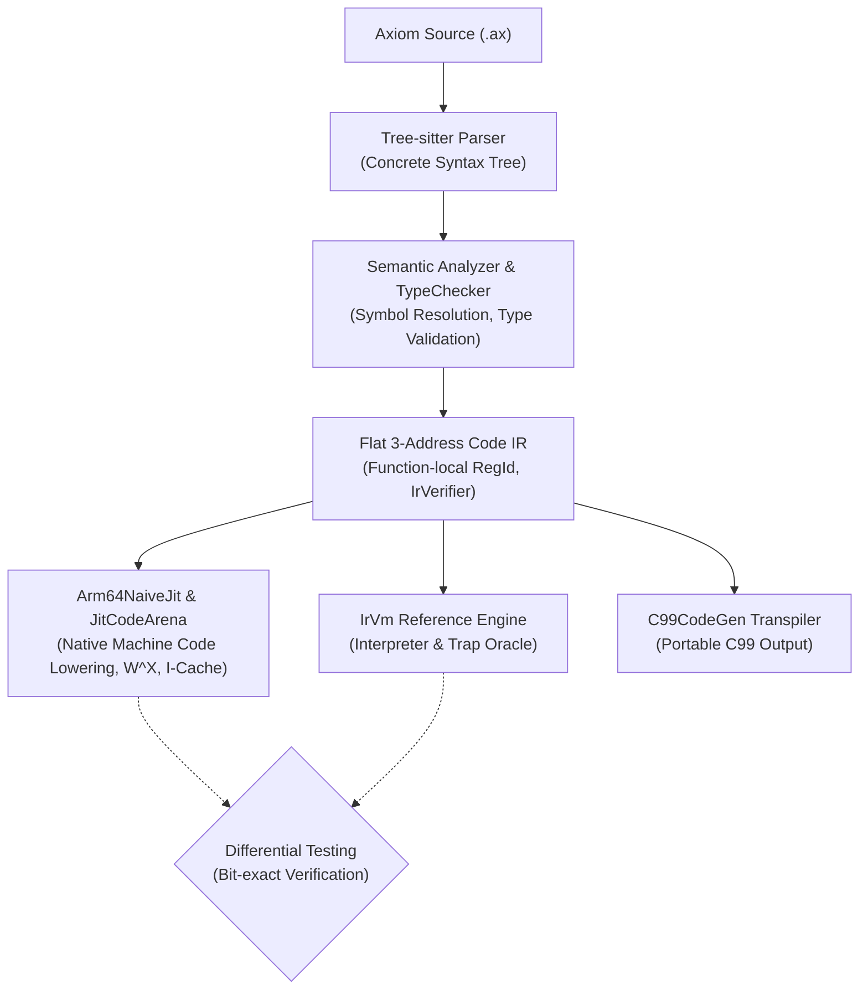

# Axiom Programming Language

<p align="center">
  <strong>High-Throughput, Data-Oriented Systems Language & Native JIT Engine</strong>
</p>

<p align="center">
  <a href="https://github.com/Nebula-Ray42/nexa/actions/workflows/ci.yml">
    
  </a>
  
  
  
  
</p>

---

## [日本語版 (Japanese Version)](README.JP.md)

---

## What is Axiom?

**Axiom** is a high-performance systems programming language designed from the ground up for **Data-Oriented Design (DOD)** and game engine architectures. 

It challenges traditional object-oriented programming by placing CPU cache locality, memory layout, and flat contiguous data structures (Structure of Arrays: SoA) at the core of its language semantics and compiler pipeline.

Currently bootstrapped in **modern C++23** with a **custom Tree-sitter grammar**, Axiom features an end-to-end compilation pipeline spanning from AST analysis and a flat 3-address IR to a **native ARM64 JIT compiler** that executes machine code directly on Apple Silicon in microseconds.

---

## Architecture & Pipeline

Axiom prioritizes deterministic throughput, zero runtime heap allocations in hot paths, and multi-tier differential verification:



* **Frontend**: Custom Tree-sitter grammar with zero-copy string interning (`StringID`) and generational handle registries.
* **Middle-End (IR)**: High-performance 3-address code IR featuring contiguous virtual registers (`RegId`), explicit control flow (`Jump`, `BranchIfFalse`, `Label`), and an automated IR Verifier.
* **Backend Tier 1 (JIT)**: Native ARM64 instruction encoder and linear code arena with cross-platform $W\oplus X$ memory protection (`MAP_JIT` on Apple Silicon, `VirtualProtect` on Windows).
* **Backend Tier 2 (IrVm)**: Strictly deterministic reference virtual machine used for differential oracle verification.

---

## Key Features

* **Data-Oriented by Default**: Declare intuitive components; the compiler automatically arranges them into cache-aligned parallel data streams (Structure of Arrays).
* **Native Machine JIT**: Emits hardware-level ARM64 instructions directly into executable memory with microsecond execution latency.
* **Differential Oracle Verification**: All compiler stages are verified against both `IrVm` and `C99CodeGen` to guarantee 100% semantic consistency.
* **Zero Runtime Heap Allocations in Hot Paths**: Arena allocators and flat index arrays prevent memory fragmentation and cache misses.
* **Modern Tooling Integration**: Native LSP compatibility (`clangd`), Tree-sitter syntax highlighting, and integrated Google Test suites.

---

## Syntax Preview

```axiom
// Components are automatically vectorized into Structure of Arrays (SoA)
component Position {
    x: float32,
    y: float32
}

component Velocity {
    vx: float32,
    vy: float32
}

// Pure function with explicit type annotations
fun update_physics(pos: Position, vel: Velocity, delta: float32) -> void {
    pos.x += vel.vx * delta;
    pos.y += vel.vy * delta;
}

fun calculate_damage(base_attack: int32, defense: int32) -> int32 {
    val effective: int32 = base_attack - (defense / 2);
    if (effective <= 0) {
        return 1;
    }
    return effective;
}
```

---

## Roadmap & Progress

| Phase | Milestone | Description | Status |
| :---: | :--- | :--- | :---: |
| **P0** | **IR Foundation** | Linear virtual registers (`RegId`), typed operands, IR Verifier & text dumper | ✅ Done |
| **P1** | **Control Flow IR** | Comparison instructions, `Label`, `Jump`, and `BranchIfFalse` lowering | ✅ Done |
| **P2** | **Reference VM (`IrVm`)** | Deterministic semantics, 32-bit wrap, trap handling (DivByZero, Overflow) | ✅ Done |
| **P3** | **ARM64 Machine Encoder** | Full 19 instruction encoders with strongly-typed `WReg` / `XReg` | ✅ Done |
| **P4** | **JIT Runtime Arena** | 64KB linear arena, $W\oplus X$ protection, cache invalidation, native CPU execution | ✅ Done |
| **P5** | **Naive JIT Compiler** | Stack-based ARM64 lowering (`Add`, `Sub`, `Mul`, `Div`, branches & loops) | 🔄 **In Progress (50%)** |
| **P6** | **Register Allocation** | Linear scan allocator (Poletto & Sarkar 1999) on non-SSA IR | ⏳ Planned |
| **P7** | **IR Optimization Pass** | Constant folding, copy propagation, and dead-code elimination | ⏳ Planned |
| **P8** | **AOT Assembly Output** | Native `.s` assembly generation for host linkers | ⏳ Planned |

---

## Building & Testing

### Prerequisites
* **CMake** (3.24 or newer)
* **C++23 compatible compiler** (Apple Clang 16+, GCC 14+, or MSVC 2022)
* **Ninja** (recommended) or Make

### Build from Source
```bash
# Clone with recursive submodules (Tree-sitter grammar)
git clone --recursive https://github.com/Nebula-Ray42/axiom.git
cd axiom

# Configure and build
cmake -B build -DCMAKE_BUILD_TYPE=Release
cmake --build build --parallel
```

### Running Test Suite
Axiom uses **Google Test** and **CTest** for Test-Driven Development (TDD). 

```bash
# Run all tests using the automated test runner (110+ tests in ~0.20s)
./scripts/shell/test.sh

# Run specific test suites
./scripts/shell/test.sh Arm64NaiveJitTest
./scripts/shell/test.sh IrVmTest
./scripts/shell/test.sh TypeCheckerTest

# Run the CLI compiler driver
./scripts/shell/test.sh run --help
```

---

## License

This project is licensed under the **[Mozilla Public License 2.0 (MPL-2.0)](LICENSE)**.

* **Core Axiom / Vanta codebase**: Covered by MPL-2.0 (modifications to existing files must remain open source).
* **Your Code / Games**: New files, commercial game logic, and proprietary engines created with or linked against Axiom remain **100% proprietary and closed-source**, with zero license viral spread.
